[README.md](https://github.com/user-attachments/files/34233033/README.md)
# Sanctum of Neurology

**English** · [ภาษาไทย](README.th.md)

An offline-first neurology lexicon for quick bedside reference and structured self-study. It runs in any browser and can be installed on a phone or computer as an app.

🔗 **Live app:** https://YOUR-USERNAME.github.io/YOUR-REPO/

<p align="center">
  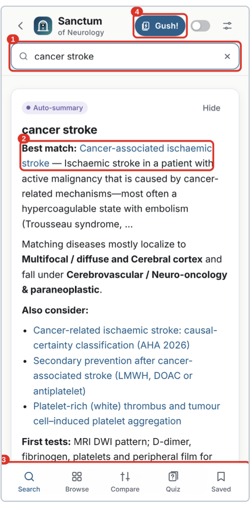
  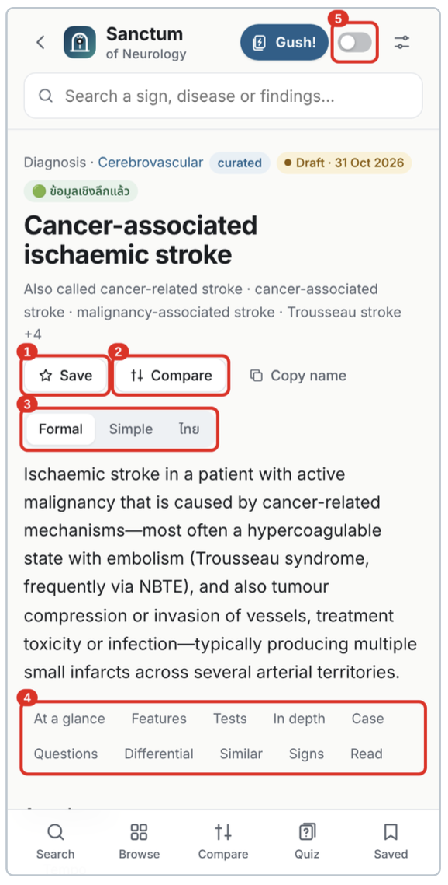
  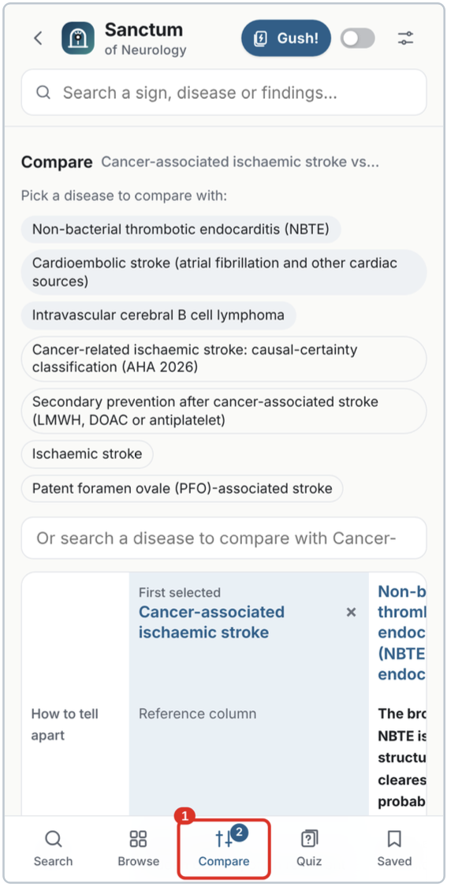
</p>

> ⚠️ **Educational tool, not a diagnostic tool.** Content is partly marked *Draft* pending expert review. Always verify doses, contraindications and institutional protocols before any clinical decision. It does not store patient data and does not replace clinical judgement.

---

## Contents

- [Features](#features)
- [What is inside](#what-is-inside)
- [Quick start](#quick-start)
- [Install as an app (offline use)](#install-as-an-app-offline-use)
- [Walkthrough](#walkthrough)
- [Quick reference](#quick-reference)
- [Privacy](#privacy)
- [Full user manual](#full-user-manual)
- [Run locally / deploy your own copy](#run-locally--deploy-your-own-copy)
- [Disclaimer](#disclaimer)
- [License](#license)

---

## Features

| | Feature | What it does |
|---|---|---|
| 🔍 | **Search + Auto-summary** | One search box for diseases, signs and synonyms. The Auto-summary card gives best match, localisation, "Also consider" differential and first tests. |
| ⚖️ | **Compare** | Place look-alike diagnoses side by side; "how to tell apart" lines target commonly confused pairs. |
| 📚 | **Disease pages** | Same layout every time: At a glance, Features, Tests, In depth, Case, Questions, Differential, Similar, Signs, Read. Definitions in Formal, Simple or Thai. |
| 🧠 | **Active recall** | Cloze it, Gush! flash cards, Quiz and Board MCQ turn the same content into practice. |
| 🗂️ | **Browse & Shadow a book** | Revise by group, localisation or tempo, or map the lexicon onto the textbook you are reading. |
| 📴 | **Offline-first** | Works without a connection after installation; check for updates on Wi-Fi. |
| 🔒 | **Privacy by design** | No patient registration or ordering. Saved items and history stay on your device. |

## What is inside

- More than **2,500 diseases** and **760 neurological signs**
- Definitions, localisation, key investigations, in-depth summaries, differentials and source references
- **Invented teaching cases** and **board-style questions** (all patients are fictional)
- Thai summaries alongside English content
- Reference-book index (200+ books) for the *Shadow a book* mode

## Quick start

1. Open the live app: https://YOUR-USERNAME.github.io/YOUR-REPO/
2. Type a finding, sign or disease in the search box (press `/` on a keyboard).
3. Read the **Auto-summary** card first, then open the best match.

## Install as an app (offline use)

1. Open the live app in your browser (HTTPS is required for installation).
2. Tap the **sliders icon** (top right) to open **Settings**.
3. Under **Install for offline use**, choose **How to install** and follow the instructions for your phone or computer.
4. When you have a connection, go to **Lexicon updates → Check for updates**. We suggest doing this once a week on Wi-Fi.

<p align="center">
  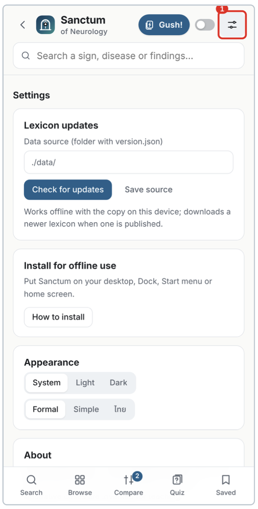
</p>

## Walkthrough

### A. Look up a diagnosis or sign

Open **Search**, type a finding, sign or disease (for example "cancer stroke"), and read the **Auto-summary** card: best match, localisation, group, "Also consider" list and first tests. Search by finding (for example "ptosis miosis") when the diagnosis is not yet clear.

<p align="center">
  
</p>

### B. Read a disease page

Check the header badges (**curated**, **Draft · date**, deep-content badge), choose the definition style (Formal / Simple / Thai), then use the jump bar to move between sections. **In depth** covers pathophysiology, clinical picture, diagnosis, treatment, prognosis and pearls.

<p align="center">
  
  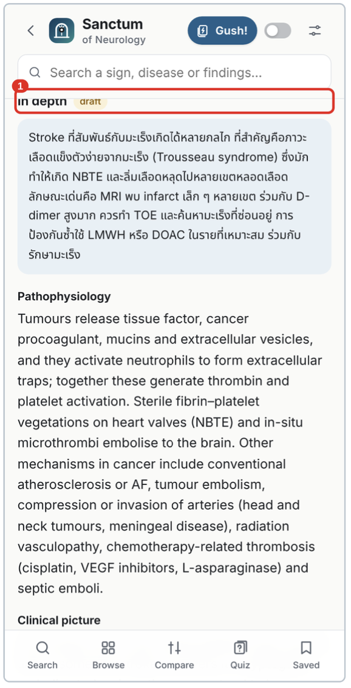
</p>

> 💡 For a rapid ward check, read only **At a glance → Key investigations → Treatment**, and return to *In depth* after the shift.

### C. Teaching cases and board-style questions

Jump to **Case**, read the patient, story, exam and tests, answer silently, then tap **Show answer**. Continue to **Questions** for multiple-choice items with explanations.

<p align="center">
  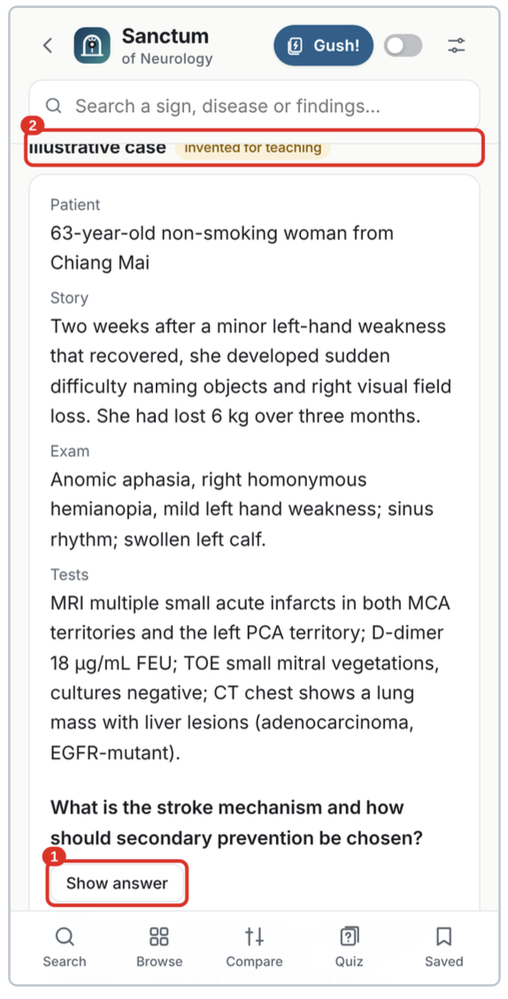
  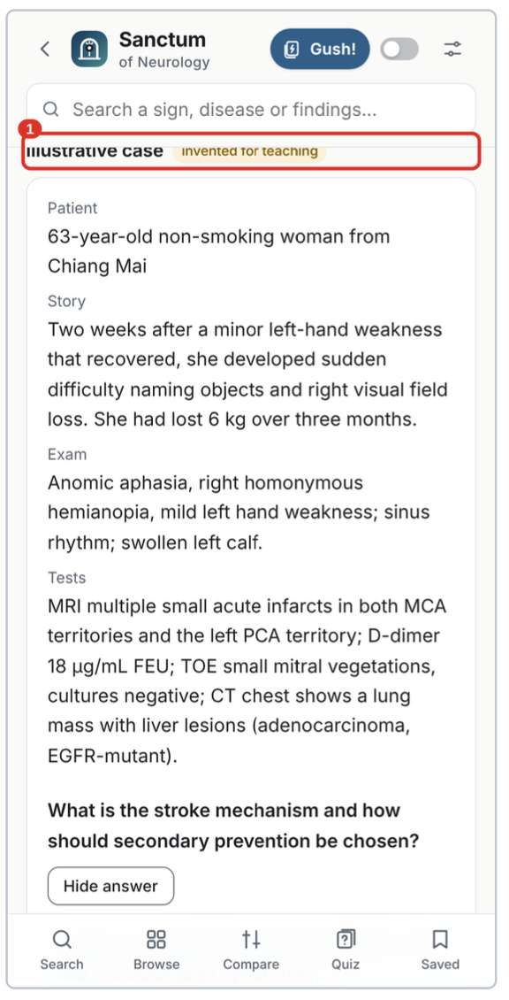
</p>

### D. Active recall: Cloze it, Gush! and Quiz

- **Cloze it:** switch on the toggle in the top bar to hide key words; tap a blank to reveal it.
- **Gush!:** choose card types (Diseases, Signs, Case quiz, Neuroscience), tap **Start Gush!**, tap a card to flip it and swipe up for the next. Cards you are unsure of return sooner.
- **Quiz:** choose Flashcards, Quiz or Board MCQ and filter by group.

<p align="center">
  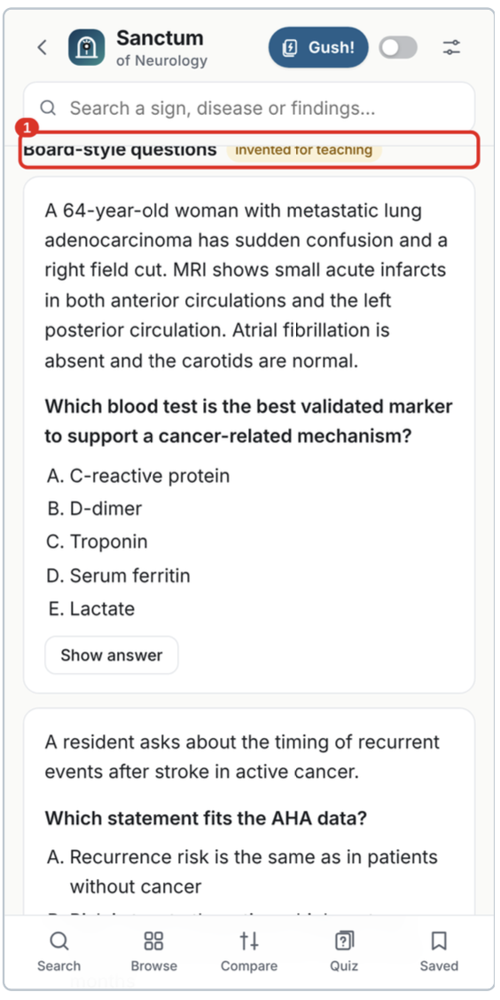
  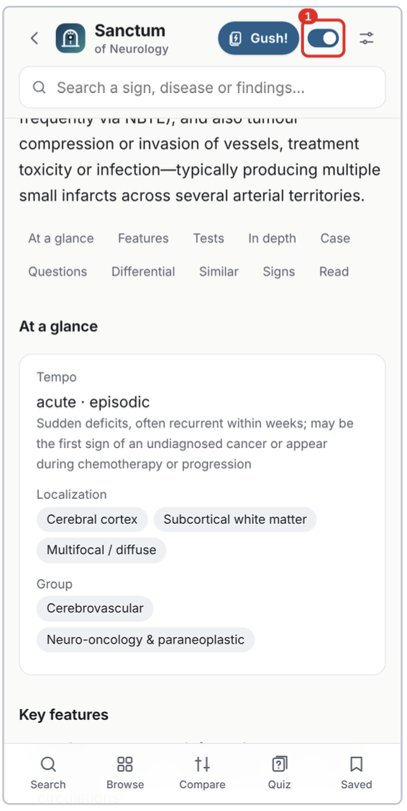
  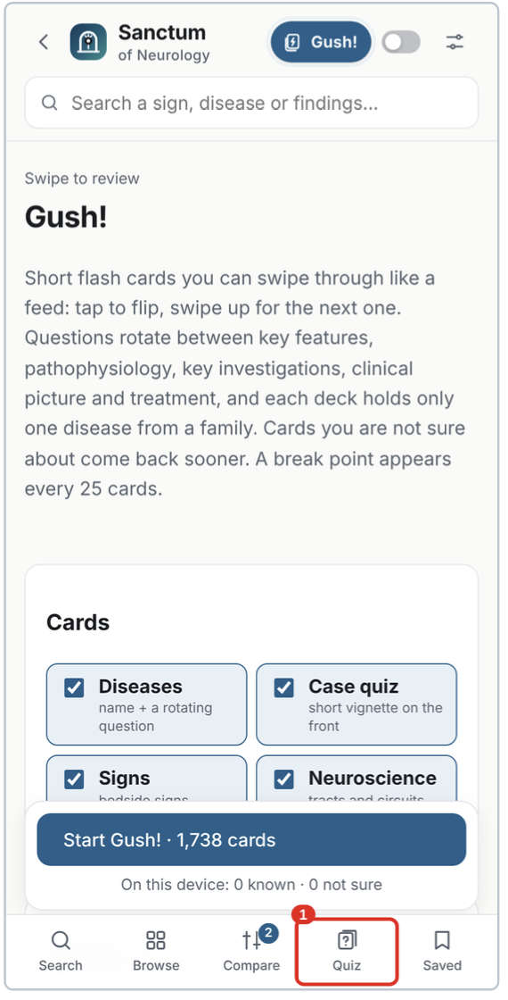
</p>

> ⚠️ Switch **Cloze it off** before using a page for patient care; hidden words can be mistaken for missing content.

### E. Compare look-alike diagnoses

On a disease page tap **Compare**, add a second disease (from the suggestions or the search field), then open the **Compare** tab and read across the rows. The first selected entry is the reference column.

<p align="center">
  
</p>

### F. Browse and Shadow a book

Open **Browse** and choose a mode: By group, By localization, By tempo, Diseases A–Z, Signs A–Z, Biomarkers, Pathogens, Neuroscience, Curated or Status. Use **Shadow a book** to pick a reference textbook and see which pages cite it, grouped by chapter or case.

<p align="center">
  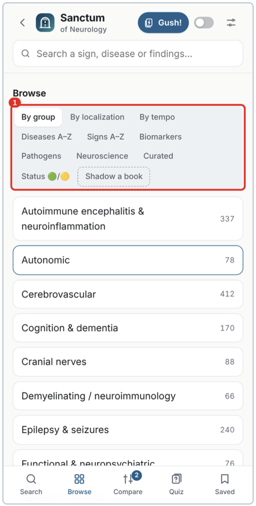
  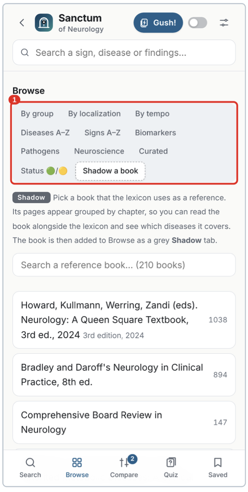
</p>

> 💡 Before a night shift, browse by **tempo → acute** for the short list of time-critical entities.

### G. Saved items, history and updates

Tap **Save** on any page and find it under the **Saved** tab. **History** lists recently opened pages. Saved items are stored only on this device and are lost if browser data is cleared or the app is reinstalled.

<p align="center">
  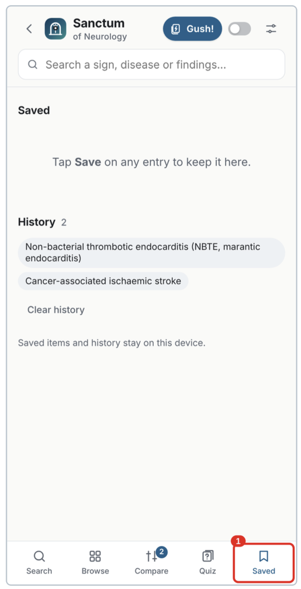
  
</p>

## Quick reference

| Feature | Button or shortcut |
|---|---|
| Search | Search tab; `/` on keyboard; `Enter` opens top result; `Esc` clears |
| Navigate result list | `↓` / `↑`, then `Enter` |
| Back / Forward | Arrows at top left; `Alt` + `←` / `→` |
| Definition style | Formal / Simple / ไทย switch under the page title |
| Jump bar | Section buttons below the definition |
| Save / Copy name | Buttons on the disease page |
| Compare | Compare button on a page, then Compare tab |
| Cloze it | Switch in the top bar |
| Gush! | Gush! button in the top bar → Start Gush! |
| Quiz | Quiz tab |
| Browse / Shadow a book | Browse tab → mode bar → Shadow a book |
| Settings / Updates | Sliders icon, top right |

## Privacy

Sanctum does not register patients, place orders or show results, and it does not collect patient data. Saved items and history remain on your device. **Do not type patient identifiers into any note field.**

## Full user manual

- 🇬🇧 [User Manual for Residents (English, PDF)](docs/Sanctum-User-Manual-Residents-EN-v0_48.pdf)
- 🇹🇭 [คู่มือการใช้งานสำหรับแพทย์ประจำบ้าน (ภาษาไทย, PDF)](docs/Sanctum-User-Manual-Residents-TH-v0_48.pdf)

## Run locally / deploy your own copy

This is a static web app, so no build step is needed. Because it uses a service worker and loads data files, open it through a local web server rather than by double-clicking `index.html`:

```bash
# from the repository root
python3 -m http.server 8000
# then open http://localhost:8000
```

To publish your own copy with GitHub Pages: **Settings → Pages → Deploy from a branch → `main` / `(root)` → Save**. The site will appear at `https://YOUR-USERNAME.github.io/YOUR-REPO/`.

Tip: if users do not see updated content after you change data files, increase the version number in `data/version.json`, then ask them to use **Check for updates**.

## Disclaimer

Content is educational and partly marked **Draft** pending expert review. Statements flagged by the authors as general knowledge have not been checked against the cited texts. Verify doses, contraindications and institutional protocols before any clinical decision. All cases are fictional and must not be copied into clinical records. A book appearing in the reference list means the lexicon used it as a reading source; it does not mean a page reproduces the book. Always cite the original text.

## License

<!-- Choose a license and add a LICENSE file, then update this section. -->
Add your license here (for example, MIT for code and CC BY-NC-SA 4.0 for content), and include the corresponding `LICENSE` file in the repository.

---

*Documentation version 0.48 · 1 November 2026*
